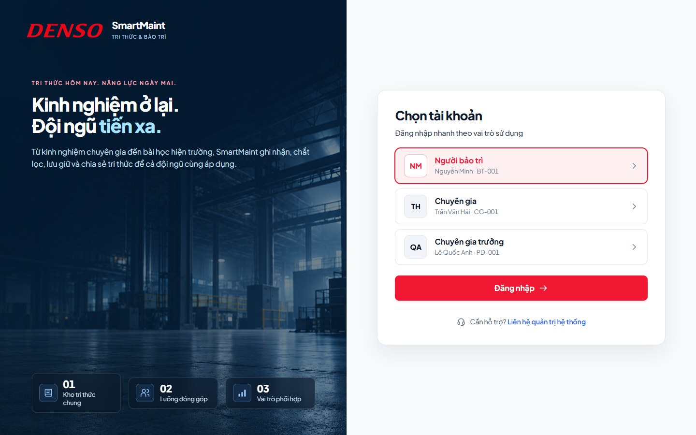
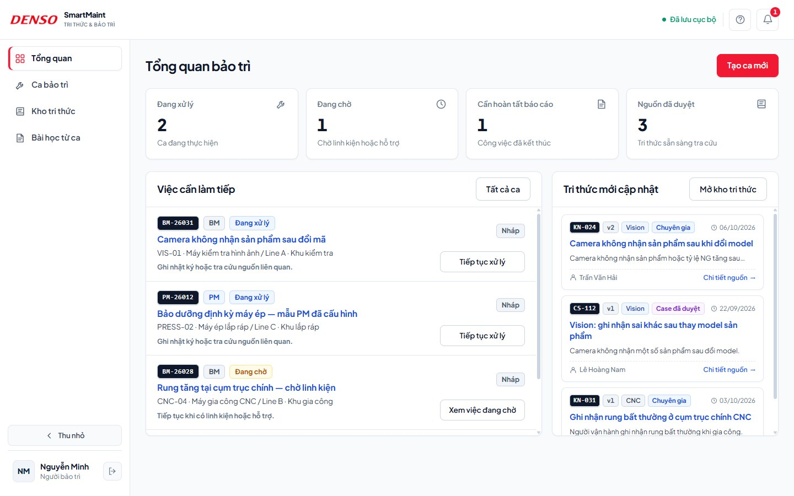
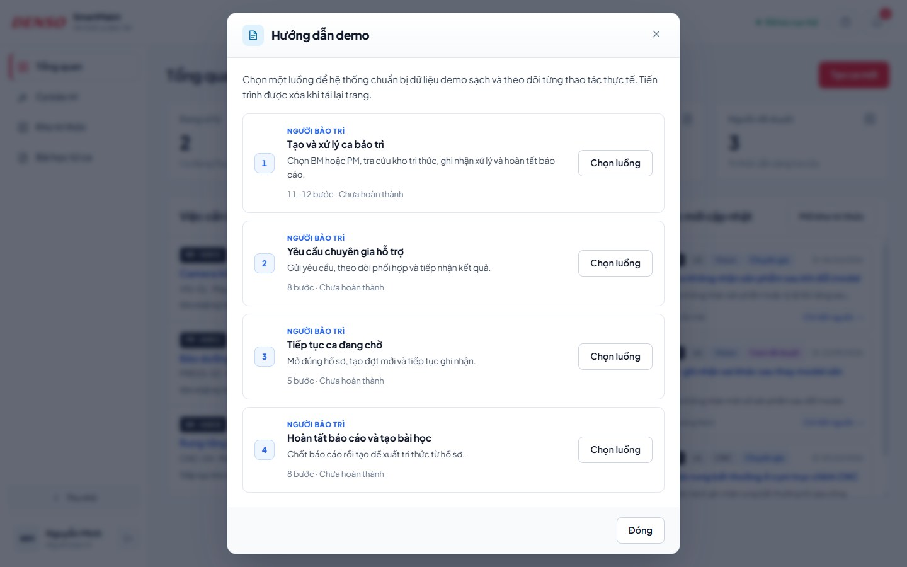
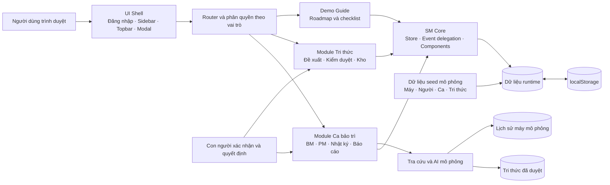
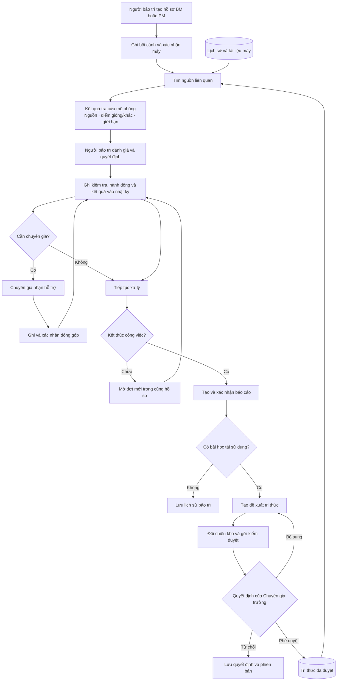

# DENSO SmartMaintAI

Prototype web mô phỏng quy trình bảo trì gắn với quản lý tri thức cho ba vai trò trong nhà máy: **Người bảo trì**, **Chuyên gia** và **Chuyên gia trưởng**.

SmartMaintAI giúp ghi lại tri thức ngay trong quá trình làm việc: tạo hồ sơ BM/PM, tra cứu nguồn đã duyệt, ghi nhật ký xử lý, phối hợp chuyên gia, tổng kết báo cáo, tạo bài học và kiểm duyệt trước khi đưa vào kho dùng chung.

> **Phạm vi prototype:** toàn bộ tài khoản, dữ liệu nhà máy, HozenDX, AI, RAG và thông báo đều là dữ liệu mô phỏng phục vụ trình diễn. Nội dung trong dự án không phải quy trình vận hành, tiêu chuẩn an toàn hoặc dữ liệu sản xuất thật của DENSO.

## 1. Điểm nổi bật

- Một hồ sơ xuyên suốt cho cả BM và PM, giữ nguyên lịch sử qua nhiều đợt xử lý.
- Quy trình bốn giai đoạn: **Bối cảnh & máy → Tra cứu & căn cứ → Xử lý & nhật ký → Báo cáo tổng kết**.
- BM và PM dùng chung luồng; PM bổ sung checklist theo mẫu của máy.
- Tra cứu tri thức đã duyệt và lịch sử máy trước khi đưa ra hướng xử lý.
- Yêu cầu hỗ trợ, nhận ca và xác nhận đóng góp giữa người bảo trì với chuyên gia.
- Tạo đề xuất tri thức từ báo cáo ca hoặc từ kinh nghiệm của chuyên gia.
- Chuyên gia trưởng có thể phê duyệt, yêu cầu bổ sung hoặc từ chối đề xuất.
- Roadmap demo riêng cho từng vai trò, tự tick khi người dùng thực hiện đúng thao tác.
- Giao diện responsive, menu có thể thu gọn và hỗ trợ desktop/mobile.
- Chạy trực tiếp bằng HTML/CSS/JavaScript, không cần cài package hoặc backend.

## 2. Hình ảnh kết quả

### Đăng nhập theo ba vai trò



### Không gian làm việc của Người bảo trì



### Roadmap hướng dẫn demo tích hợp



## 3. Chạy prototype

### Chạy nhanh bằng Docker

Yêu cầu: Docker Desktop hoặc Docker Engine đang hoạt động.

```bash
git clone https://github.com/Hoafng3107/Denso_SmartmaintAI.git
cd Denso_SmartmaintAI
docker build -t denso-smartmaintai .
docker run --rm -p 8080:80 --name denso-smartmaintai denso-smartmaintai
```

Mở `http://localhost:8080`, sau đó chọn một tài khoản demo. Dừng container bằng `Ctrl+C`.

Chạy nền:

```bash
docker run -d --rm -p 8080:80 --name denso-smartmaintai denso-smartmaintai
```

Kiểm tra trạng thái và dừng container:

```bash
docker ps
docker stop denso-smartmaintai
```

Docker image dùng Nginx Alpine, chỉ chứa các file cần để chạy prototype. `HEALTHCHECK` gọi trực tiếp trang chủ trong container.

### Mở trực tiếp

1. Clone hoặc tải mã nguồn về máy.
2. Mở `index.html` bằng Microsoft Edge hoặc Google Chrome.
3. Chọn một trong ba tài khoản ở màn hình đăng nhập.

Prototype hỗ trợ `file://`, vì vậy có thể mở trực tiếp mà không cần cài đặt.

### Dùng máy chủ tĩnh

Có thể dùng Live Server trong VS Code hoặc bất kỳ HTTP server tĩnh nào. Ví dụ với Python:

```bash
python -m http.server 8080
```

Sau đó mở `http://localhost:8080`.

Kết nối Internet chỉ được dùng để tải font Plus Jakarta Sans từ Google Fonts. Khi ngoại tuyến, trình duyệt dùng font hệ thống thay thế và nghiệp vụ demo vẫn hoạt động.

## 4. Tài khoản và vai trò

| Vai trò | Tài khoản demo | Mã | Trách nhiệm chính |
| --- | --- | --- | --- |
| Người bảo trì | Nguyễn Minh | BT-001 | Tạo và sở hữu hồ sơ BM/PM, tra cứu, ghi công việc, yêu cầu hỗ trợ, tổng kết báo cáo |
| Chuyên gia | Trần Văn Hải | CG-001 | Nhận hỗ trợ, tham gia hồ sơ, xác nhận đóng góp và tạo tri thức chuyên môn |
| Chuyên gia trưởng | Lê Quốc Anh | PD-001 | Rà nguồn, kiểm duyệt và quyết định nội dung được xuất bản vào kho tri thức |

Không cần mật khẩu. Đây là cơ chế chuyển vai trò nhanh dành riêng cho prototype.

## 5. Luồng nghiệp vụ chính

### 5.1. Tạo và xử lý ca BM/PM

1. Người bảo trì chọn **Tạo ca mới**.
2. Chọn BM hoặc PM, máy cần xử lý và xác nhận đúng máy thực tế.
3. Kiểm tra bối cảnh và thông tin máy ở Giai đoạn 1.
4. Sang Giai đoạn 2 và chọn **Tìm nguồn liên quan**.
5. Theo dõi tiến trình tra cứu mô phỏng, đọc tri thức đã duyệt và lịch sử máy.
6. Sang Giai đoạn 3 để ghi kiểm tra, hành động và kết quả.
7. Với PM, hoàn thành checklist; mục Không đạt phải có ghi chú và điều tra bất thường.
8. Lưu kết quả đợt, chọn tiếp tục, chờ linh kiện/hỗ trợ, bàn giao hoặc kết thúc công việc.
9. Khi kết thúc, sang Giai đoạn 4 để tạo nháp, đối chiếu và chốt báo cáo.

BM và PM đều có bước tra cứu kho. Khác biệt chính là PM có checklist được cấu hình theo máy.

### 5.2. Phối hợp chuyên gia

1. Người bảo trì mở một hồ sơ đang xử lý và ghi đủ bối cảnh ban đầu.
2. Gửi yêu cầu hỗ trợ, chọn chuyên gia và mô tả vấn đề cần làm rõ.
3. Chuyển sang tài khoản Chuyên gia.
4. Chuyên gia mở **Hỗ trợ & xác nhận**, nhận yêu cầu và bắt đầu tham gia.
5. Chuyên gia ghi đánh giá chuyên môn và xác nhận phần đóng góp của mình.
6. Quay lại Người bảo trì để xem kết quả, cập nhật nhật ký và quyết định bước tiếp theo.

Người bảo trì vẫn là chủ hồ sơ; chuyên gia được ghi nhận là người tham gia và người thực hiện nội dung chuyên môn tương ứng.

### 5.3. Tiếp tục hồ sơ đang chờ

- Trạng thái chờ linh kiện hoặc chờ hỗ trợ không đóng hồ sơ.
- Khi điều kiện được đáp ứng, người bảo trì chọn **Tiếp tục xử lý**.
- Hệ thống tạo đợt mới trong cùng case ID và giữ nguyên toàn bộ nhật ký trước đó.

### 5.4. Tạo và kiểm duyệt tri thức

Tri thức có thể bắt đầu theo hai cách:

- Người bảo trì tạo bài học từ báo cáo ca đã xác nhận.
- Chuyên gia chủ động ghi một kinh nghiệm chuyên môn mới.

Tác giả chắt lọc ghi chú, hoàn thiện biểu mẫu, đối chiếu kho hiện có và gửi kiểm duyệt. Chuyên gia trưởng kiểm tra nguồn rồi chọn:

- **Phê duyệt và xuất bản:** nội dung trở thành tri thức có thể tra cứu.
- **Yêu cầu bổ sung:** trả lại tác giả cùng phản hồi cụ thể.
- **Từ chối:** lưu quyết định và lịch sử phiên bản, không đưa vào kho.

Nháp và đề xuất chưa duyệt không được dùng làm nguồn tra cứu cho ca bảo trì.

## 6. Hướng dẫn demo tích hợp

Nút **Hướng dẫn demo** nằm trên topbar của từng vai trò.

- Danh sách luồng được đánh số từ 1 và thay đổi theo vai trò.
- Mỗi bước mô tả chính xác màn hình, nút và dữ liệu cần thao tác.
- Nút **Đi đến màn hình** mở đúng case, proposal hoặc tab của bước hiện tại.
- Checklist chỉ tick khi action, biểu mẫu và ID hồ sơ khớp với luồng đang chạy.
- Thao tác trên hồ sơ khác hoặc sai thứ tự không làm hoàn thành bước.
- Có thể đóng cửa sổ rồi mở lại mà không mất tiến trình trong phiên trang hiện tại.
- Nút **Làm lại từ đầu** khởi tạo lại dữ liệu và roadmap đang chọn.
- Tiến trình và danh sách luồng hoàn thành được xóa khi tải lại trang.

Khi bắt đầu một roadmap mới, dữ liệu nghiệp vụ demo được đưa về trạng thái seed để kịch bản có thể lặp lại ổn định.

## 7. Kịch bản trình diễn đề xuất

1. Đăng nhập Người bảo trì và mở **Hướng dẫn demo**.
2. Chọn **Tạo và xử lý ca bảo trì**.
3. Chọn BM hoặc PM, tạo hồ sơ, tra cứu nguồn và ghi nhật ký.
4. Thử luồng **Yêu cầu chuyên gia hỗ trợ** với BM-26031.
5. Chuyển sang Chuyên gia, chọn **Nhận yêu cầu hỗ trợ** và ghi đóng góp.
6. Quay lại Người bảo trì để cập nhật kết quả và hoàn tất báo cáo.
7. Chuyển sang Chuyên gia trưởng, mở luồng kiểm duyệt và xuất bản DP-026.
8. Mở Kho tri thức để kiểm tra nội dung vừa được duyệt.

Nếu cần trình diễn PM, chọn PM ngay khi tạo ca. Checklist PM tự xuất hiện trong roadmap và Giai đoạn 3.

## 8. Dữ liệu và trạng thái

- Dữ liệu seed nằm trong `prototype/data.js`, `prototype/cases.js` và `prototype/knowledge.js`.
- Dữ liệu thao tác nghiệp vụ được lưu bằng `localStorage` trên trình duyệt hiện tại.
- Roadmap chỉ giữ trong bộ nhớ của phiên trang và reset khi tải lại.
- Nút đặt lại dữ liệu trong giao diện khôi phục dữ liệu mô phỏng ban đầu.
- Prototype không gửi dữ liệu đến server hoặc dịch vụ bên ngoài.

Các nhóm trạng thái được quản lý độc lập:

- **Máy:** chưa xác minh, đã phục hồi, chưa phục hồi.
- **Công việc:** đang xử lý, đang chờ, đã kết thúc.
- **Báo cáo:** nháp, chờ hoàn tất, cần bổ sung, đã xác nhận.
- **Đề xuất:** nháp, chờ duyệt, cần bổ sung, từ chối, đã xuất bản hoặc lưu trữ.

## 9. Kiến trúc hệ thống

Prototype được thiết kế theo kiến trúc frontend module hóa. Tất cả nghiệp vụ chạy trong trình duyệt; không có backend hoặc API thật trong phiên bản hackathon.



### Thành phần chính

| Thành phần | Trách nhiệm |
| --- | --- |
| `app.js` | Đăng nhập, layout ứng dụng, dashboard, menu và chuyển vai trò |
| `prototype/core.js` | Store, router, localStorage, modal, helper giao diện và event delegation |
| `prototype/data.js` | Dữ liệu seed về người dùng, máy, tài liệu và tri thức đã duyệt |
| `prototype/cases.js` | Vòng đời hồ sơ BM/PM, tra cứu, nhật ký, phối hợp và báo cáo |
| `prototype/knowledge.js` | Soạn đề xuất, đối chiếu, kiểm duyệt, phiên bản và xuất bản tri thức |
| `prototype/demo-guide.js` | Roadmap theo vai trò và kiểm tra đúng thao tác theo case/proposal |
| Nginx trong Docker | Phục vụ các file tĩnh và fallback về `index.html` |

### Ranh giới prototype

- HozenDX, AI/RAG, người dùng và dữ liệu thiết bị đều được mô phỏng.
- `localStorage` đóng vai trò kho dữ liệu cục bộ thay cho backend.
- Chỉ tri thức có trạng thái đã duyệt được đưa vào tập nguồn tra cứu.
- AI không tự ra quyết định; người dùng xác nhận nội dung và Chuyên gia trưởng kiểm duyệt trước khi tái sử dụng.

## 10. Sơ đồ luồng dữ liệu



Luồng tạo thành vòng lặp học hỏi: dữ liệu công việc được ghi có cấu trúc, con người xác nhận, tri thức được kiểm duyệt và quay lại phục vụ ca tiếp theo.

## 11. Cấu trúc mã nguồn

Ứng dụng dùng JavaScript thuần và namespace chung `window.SM`.

```text
.
├── index.html                         # Điểm vào ứng dụng
├── app.js                             # Đăng nhập, shell, dashboard và điều hướng
├── styles.css                         # Design system và responsive layout
├── Dockerfile                         # Docker image Nginx phục vụ prototype
├── nginx.conf                         # Cấu hình static hosting và security headers
├── .dockerignore                      # Giảm Docker build context
├── prototype/
│   ├── core.js                        # Store, router, helper, modal, event delegation
│   ├── data.js                        # Tài khoản, máy và tri thức seed
│   ├── cases.js                       # Hồ sơ BM/PM, hỗ trợ, nhật ký và báo cáo
│   ├── knowledge.js                   # Đề xuất, đối chiếu, kiểm duyệt và kho tri thức
│   └── demo-guide.js                  # Roadmap demo theo vai trò
├── scripts/
│   ├── check-presentation.cjs         # Smoke test desktop/mobile và ba vai trò
│   ├── check-demo-guide.cjs           # Test BM/PM, reset và chống tick sai
│   ├── capture-readme.cjs             # Tạo lại ảnh chụp dùng trong README
│   └── build-*.cjs                    # Sinh tài liệu BPMN/sequence
└── docs/
    ├── images/                        # Ảnh chụp giao diện cho README
    ├── prototype/                     # Đặc tả prototype
    ├── bpmn/                          # Sơ đồ nghiệp vụ
    ├── sequence/                      # Biểu đồ tuần tự
    └── diagram-archive/               # Nguồn cũ cần cho script tạo sơ đồ
```

Thứ tự script trong `index.html` cần được giữ nguyên:

1. `prototype/core.js`
2. `prototype/data.js`
3. `prototype/knowledge.js`
4. `prototype/cases.js`
5. `app.js`
6. `prototype/demo-guide.js`

## 12. Kiểm thử

Dự án không có dependency và không dùng `npm`. Hai script kiểm thử kết nối Chrome qua Chrome DevTools Protocol tại cổng `9334`.

Khởi chạy Chrome headless trên Windows:

```powershell
& 'C:\Program Files\Google\Chrome\Application\chrome.exe' `
  --headless=new `
  --remote-debugging-port=9334 `
  --user-data-dir="$PWD\.ui-check-cdp-profile"
```

Chạy kiểm thử:

```powershell
node scripts/check-presentation.cjs
node scripts/check-demo-guide.cjs
node scripts/capture-readme.cjs
git diff --check
```

Phạm vi kiểm tra:

- Roadmap của cả ba vai trò.
- Tạo ca BM và điều hướng đúng case/tab.
- Tạo ca PM và hiển thị checklist đúng nhánh.
- Tra cứu, chuyển bước và giữ tiến trình.
- Không tick khi thao tác trên sai hồ sơ.
- Nhận hỗ trợ chuyên gia và giữ roadmap khi đổi tài khoản.
- Kiểm duyệt đúng proposal ID.
- Reset roadmap khi tải lại trang.
- Modal không tràn viewport desktop/mobile.

Script `capture-readme.cjs` tạo lại ba ảnh trong `docs/images/` khi Chrome CDP đang chạy.

### Kiểm tra Docker

```bash
docker build -t denso-smartmaintai .
docker run -d --rm -p 8080:80 --name denso-smartmaintai denso-smartmaintai
docker inspect --format='{{json .State.Health}}' denso-smartmaintai
docker stop denso-smartmaintai
```

## 13. Tài liệu nghiệp vụ

- [Hướng dẫn và phạm vi prototype](docs/prototype/README.md)
- [Sơ đồ BPMN](docs/bpmn/README.md)
- [Biểu đồ tuần tự](docs/sequence/README.md)
- [Đặc tả luồng tối ưu](docs/sequence/optimized-flow-contract.md)
- [Đặc tả giao tiếp prototype](docs/sequence/prototype-spec.md)

Các file `.drawio` ở thư mục gốc có thể chỉnh sửa bằng diagrams.net/draw.io.

## 14. Giới hạn và hướng phát triển

Prototype hiện chưa có:

- Backend, cơ sở dữ liệu dùng chung hoặc đăng nhập thật.
- Đồng bộ API với HozenDX hay hệ thống quản lý bảo trì khác.
- LLM, embeddings, vector database hoặc RAG thật.
- File đính kèm, ảnh hiện trường hoặc phân quyền cấp nhà máy.
- Nhật ký bảo mật và cơ chế phê duyệt đủ điều kiện production.

Hướng tiếp theo là thay lớp dữ liệu mô phỏng bằng API, bổ sung xác thực và phân quyền, lưu audit bất biến, kết nối kho tài liệu có kiểm soát phiên bản và xây dựng pipeline AI có đánh giá nguồn cùng cơ chế phê duyệt của con người.

## 15. Trình duyệt hỗ trợ

Khuyến nghị phiên bản mới của Google Chrome hoặc Microsoft Edge. Prototype sử dụng `dialog`, `localStorage`, CSS Grid/Flexbox và JavaScript hiện đại. Internet Explorer không được hỗ trợ.

## 16. Bản quyền và sử dụng

Dự án được xây dựng cho mục đích prototype/hackathon và trình diễn nội bộ. Logo, tên thương hiệu và tài sản nhận diện thuộc chủ sở hữu tương ứng. Không sử dụng dữ liệu hoặc hướng dẫn mô phỏng trong dự án để vận hành thiết bị thực tế.
